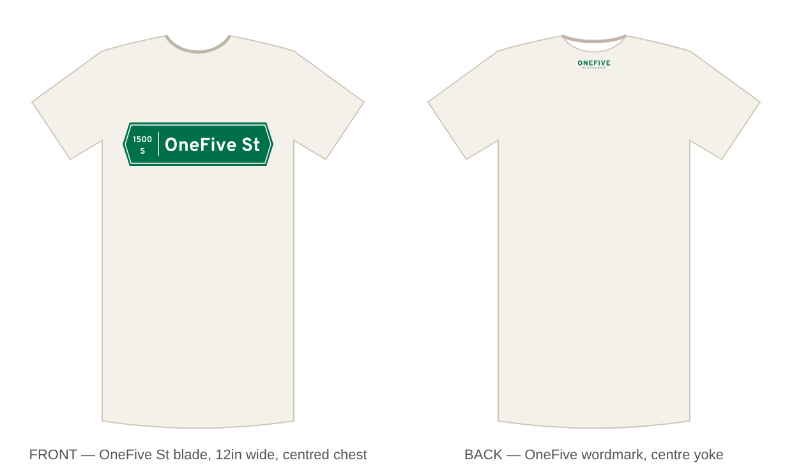

# OneFive tee



| File | Placement | Size | Ink |
|---|---|---|---|
| `front-street-sign.svg` | Front, centred chest, ~3.5in below collar | 11in × 3.1in | Green `#41715C`, white, gold `#E3B23C` |
| `front-street-sign-no-st.svg` | Alternate front: same sign, no "ST" | 11in × 3.1in | Same as front |
| `back-yoke-onefive.svg` | Back, centre yoke, ~1in below collar seam | 4in × 0.8in | Green `#41715C` |

The front recreates the city's newer street sign (the PALMER ST style): a green sign with a raised, angled top, the `← 1400 N 1500 →` block band with a gold N, the gold Liberty Bell, and **ONEFIVE** in place of the street name, with a smaller **ST**. Three-colour print; on a dark tee the green blade frames everything.

All text is converted to outlines — no fonts needed to print. Shown on a natural tee.

## Regenerating

`gen.py` builds both SVGs from Overpass Bold/ExtraBold (SIL OFL, a free road-sign face close to the Clearview the city uses); `mock.py` builds `mockup.svg`.

```sh
pip install fonttools
mkdir fonts && curl -L -o fonts/Overpass.ttf "https://raw.githubusercontent.com/google/fonts/main/ofl/overpass/Overpass%5Bwght%5D.ttf"
python3 -m fontTools.varLib.instancer fonts/Overpass.ttf wght=700 -o fonts/Overpass-Bold.ttf
python3 -m fontTools.varLib.instancer fonts/Overpass.ttf wght=800 -o fonts/Overpass-XB.ttf
python3 gen.py . && python3 mock.py .
```
